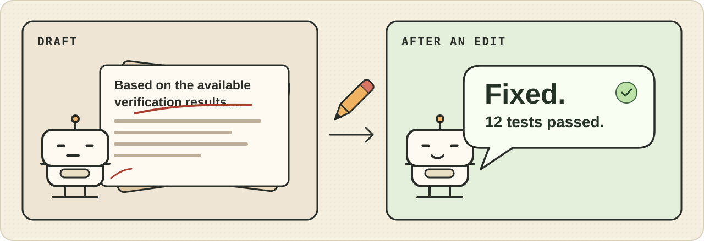

# GPT Think But No Speak

**代码修好了，话还在开会。**



这是给 Codex 和其他 Agent 用的表达顾问。发进度、说卡点、交结果前，Agent 把原稿交给一个更会说话的模型，请它说说哪里绕、怎么说更自然。最后由 Agent 核对事实，自己定稿。

## 「所以，测过了吗？」

**原稿（示例）**

> 基于当前可核验的结果，导出流程中的异常已完成修复，且在本地执行的 12 项测试均已通过。需要说明的是，打包产物仍处于待验证状态。

**表达意见（示例）**

> 「基于当前可核验的结果」和「需要说明的是」都在打铺垫。直接说修了什么、测了什么，再交代还有哪一步没检查。

**建议文案（示例）**

> 导出问题修好了，本地 12 项测试全过。打包产物还没检查。

## 它怎么工作

1. **Agent 写原稿。** 内容可以是进度、卡点或最后的结果。
2. **表达顾问给意见和建议文案。** [脚本](scripts/polish.py) 把原稿发给你配置的 Chat Completions 接口，在标准输出返回这两部分。
3. **Agent 定稿。** 对照原文看数字、路径、命令和没确认的事有没有变，再决定怎么发。接口超时或没给出可用建议，就用原稿继续。

## 装上试试

需要 Python 3.10 或更新版本。脚本只用 Python 标准库。

```sh
git clone \
  https://github.com/LangQi99/gpt-think-but-no-speak.git \
  "${CODEX_HOME:-$HOME/.codex}/skills/gpt-think-but-no-speak"
```

在 Codex 里用 `$gpt-think-but-no-speak`。首次使用时，Agent 会询问缺少的接口地址（`base_url`）、模型 ID（`model`）和密钥来源。配置保存到本机，之后直接复用。仓库里的 [配置模板](config.example.json) 留空，具体步骤见 [SKILL.md](SKILL.md#首次配置)。

配置好后也能在技能目录直接试一句：

```sh
python3 scripts/polish.py -- '本地 12 项测试都通过了，打包还没看。'
```

## 这个梗从哪来

中文开发者把「收窄、坐实、兜住、收口」扎堆出现的写法叫「AI 工程腔」。英语社区也常讨论 GPT 爱把句子说成 “It’s not X, it’s Y”。这些口癖和层层铺垫在长文章里容易被看见，在短短一条进度里更扎眼。 [LINUX DO 原帖](https://linux.do/t/topic/1830516) · [r/ChatGPT 讨论](https://www.reddit.com/r/ChatGPT/comments/1um6g76/why_do_ai_models_keep_using_not_x_but_y/)

[Humanizer](https://github.com/blader/humanizer) 把常见的 AI 写作模式整理成了编辑规则，[维基百科的社区整理](https://en.wikipedia.org/wiki/Wikipedia:Signs_of_AI_writing#Negative_parallelisms) 也收录了类似句型。这个项目把编辑放到一个具体时刻：任务还在跑，或者刚做完，Agent 正要把那几句话发给人。
